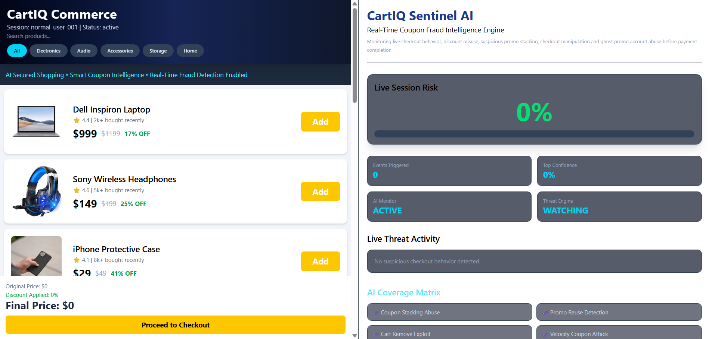
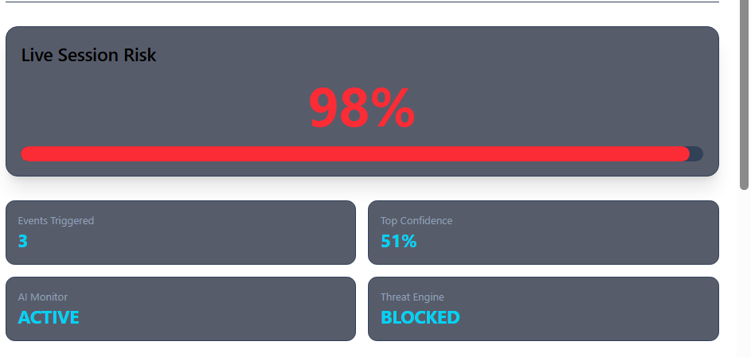
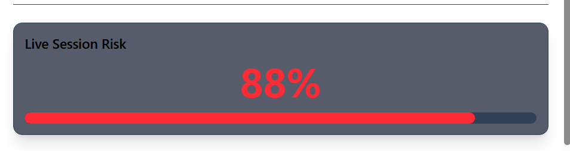
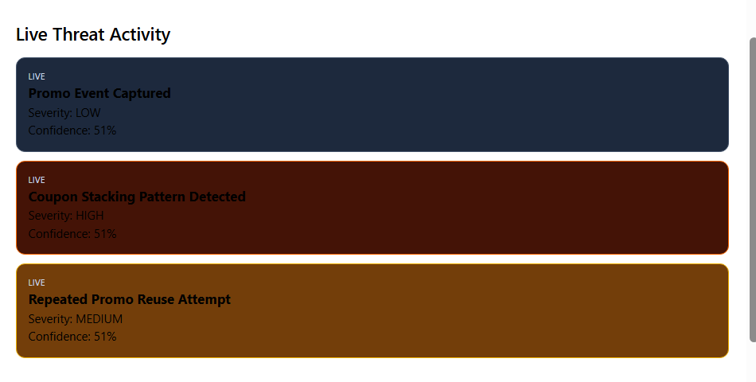

# CartIQ AI – Smart Retail Fraud Detection System

CartIQ AI is an AI-powered retail fraud detection platform that detects suspicious shopping cart and coupon abuse behavior in real time.

## Features
- Real-time fraud detection
- Coupon stacking detection
- Repeated coupon abuse detection
- Cart manipulation detection
- High discount abuse detection
- Ghost/deleted account detection
- Live risk scoring
- WebSocket-based real-time communication
- Machine learning powered fraud analysis

## Tech Stack

Frontend:
- React
- Vite
- Tailwind CSS
- Framer Motion
- Socket.IO Client

Backend:
- Node.js
- Express.js
- Socket.IO
- Axios

Machine Learning:
- Python
- Flask
- Scikit-learn
- Random Forest

## Project Structure

CartIQ-AI/
├── frontend/
├── backend/
├── ml/
├── screenshots/
├── README.md
└── .gitignore

## Installation

### Frontend
```bash
cd frontend
npm install
npm run dev
```

### Backend
```bash
cd backend
npm install
npm start
```

### ML API
```bash
cd ml
pip install flask scikit-learn pandas numpy joblib
python ml_api.py
```

## How It Works
1. User performs shopping cart actions
2. Backend collects session behavior
3. ML API analyzes fraud indicators
4. Risk score is generated
5. Alerts/events are shown in real time

## Fraud Indicators
- Multiple coupon usage
- Repeated coupon reuse
- Removing items after applying coupons
- Large discount exploitation
- Fast suspicious coupon behavior
- Ghost account misuse

## Future Improvements
- Real payment gateway integration
- Database integration
- User authentication
- Cloud deployment
- Better fraud model with real datasets

## Screenshots

### Dashboard


### Fraud Detection Alert


### Risk Gauge


### Detection Panel


## Author
Shashank